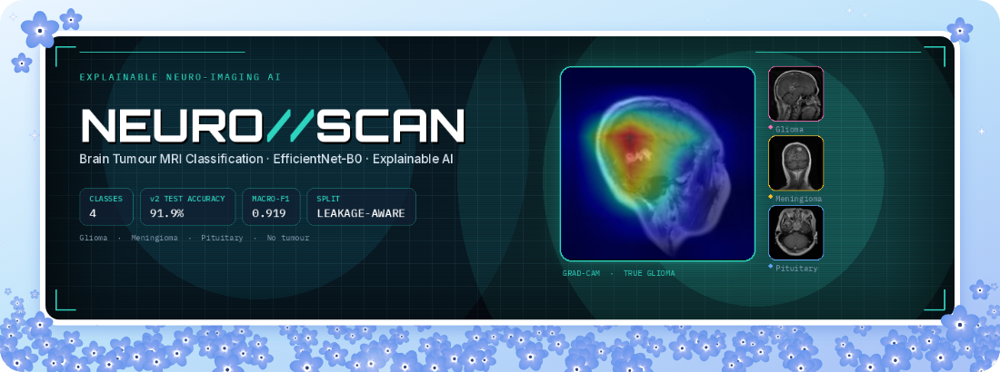

<h1>Nishtha Kalia — BCA, Machine Learning &amp; Explainable AI</h1>

<b>Medical image classification · Brain tumour MRI · Explainable AI · Model calibration · Fairness &amp; Responsible AI</b> 
Department of Computer Science and Applications, Mehr Chand Mahajan DAV College for Women, Panjab University, Chandigarh, India

##  About me

I'm a BCA student at the Department of Computer Science and Applications, Mehr Chand Mahajan DAV College for Women, Panjab University, Chandigarh.
I'm interested in machine learning that can be trusted: leakage-aware data splits, calibrated confidence and explanations that are actually tested.

**What I work on**
- 🧠 **Medical image classification**: brain tumour MRI classification with EfficientNet-B0 and a near-duplicate audit to prevent data leakage.
- 🔍 **Explainable AI (XAI)**: Grad-CAM, Grad-CAM++, Integrated Gradients, occlusion, KernelSHAP and LIME, with faithfulness and sanity checks.
- 🌡️ **Model calibration**: temperature scaling and an "uncertain" flag for low-confidence predictions.
- ⚖️ **Responsible AI and fairness**: co-author of a fairness, explainability and governance audit on the UCI Adult dataset.
- 🤖 **Agentic AI engineering**: contributor to the *Agentic Engineering* ebook on building secure, human-centred SaaS with AI coding agents.
- 🌐 **In-browser ML demos**: ONNX models running client-side on GitHub Pages.
 

##  Featured project: brain tumour MRI classification

**[Brain Tumour MRI Classification: Leakage-Aware, Calibrated and Explainable EfficientNet-B0](https://github.com/nishthaakalia/brain-tumor-mri-classification)** 
4 classes · v2: 91.9% test accuracy, 0.919 macro-F1 · temperature scaling · 6 sanity-checked XAI methods (Grad-CAM, Grad-CAM++, Integrated Gradients, occlusion, KernelSHAP, LIME) · in-browser ONNX demo

##  Projects

| Project | What it is | Links |
|---|---|---|
| [**brain-tumor-mri-classification**](https://github.com/nishthaakalia/brain-tumor-mri-classification) | Leakage-aware, calibrated and explainable EfficientNet-B0 for brain tumour MRI classification (glioma, meningioma, pituitary, no tumour), with v1/v2 white papers and Colab notebooks | [Live demo](https://nishthaakalia.github.io/brain-tumor-mri-classification/) · [v2 white paper](https://github.com/nishthaakalia/brain-tumor-mri-classification/blob/main/v2/paper/brain_tumor_mri_white_paper.pdf) · [v1 white paper](https://github.com/nishthaakalia/brain-tumor-mri-classification/blob/main/v1/paper/brain_tumor_mri_white_paper.pdf) |
| [**responsible-ai-uci-adult**](https://github.com/nishthaakalia/responsible-ai-uci-adult) (fork) | Fork of the Responsible AI audit on UCI Adult (fairness, SHAP/LIME/permutation explanations, governance crosswalk), the project I co-authored | [Original repository](https://github.com/Rishabh-bgp/responsible-ai-uci-adult) · [FAIR//AUDIT dashboard](https://rishabh-bgp.github.io/responsible-ai-uci-adult/) |
| **Contributor — [Agentic Engineering Ebook](https://github.com/Rishabh-bgp/Agentic-Engineering-Ebook)** | *Agentic Engineering: Building Secure, Human-Centered SaaS with AI Tools*, a practical book in notebook form on specifying, generating, verifying and refining multi-tenant SaaS when coding agents write most of the code | [Upstream repository](https://github.com/Rishabh-bgp/Agentic-Engineering-Ebook) · [My fork](https://github.com/nishthaakalia/Agentic-Engineering-Ebook) |

##  Research, publications and contributions

- **Nishtha Kalia** · *Brain Tumour MRI Classification: Leakage-Aware, Calibrated and Explainable EfficientNet-B0*, white paper, 2026 · [v2 PDF](https://github.com/nishthaakalia/brain-tumor-mri-classification/blob/main/v2/paper/brain_tumor_mri_white_paper.pdf) · [v1 PDF](https://github.com/nishthaakalia/brain-tumor-mri-classification/blob/main/v1/paper/brain_tumor_mri_white_paper.pdf)
- Nikshep Paliwal, Rishabh Aryan, **Nishtha Kalia** · *Responsible AI on UCI Adult: Fairness, Explainability & Governance Audit* (project title; co-author: literature review, documentation and writing, results validation) · [project repository](https://github.com/nishthaakalia/responsible-ai-uci-adult)
- **Contributor — Agentic Engineering Ebook** · *Agentic Engineering: Building Secure, Human-Centered SaaS with AI Tools*, a practical book in notebook form on specifying, generating, verifying and refining multi-tenant SaaS when coding agents write most of the code · [upstream repository](https://github.com/Rishabh-bgp/Agentic-Engineering-Ebook) · [my fork](https://github.com/nishthaakalia/Agentic-Engineering-Ebook)

##  Tech stack

##  Find me

