I'm a BCA student at the Department of Computer Science and Applications, Mehr Chand Mahajan DAV College for Women, Panjab University, Chandigarh.
I'm interested in machine learning that can be trusted: leakage-aware data splits, calibrated confidence and explanations that are actually tested.
 

### 💙 Featured project ✨

**[Brain Tumour MRI Classification: Leakage-Aware, Calibrated and Explainable EfficientNet-B0](https://github.com/nishthaakalia/brain-tumor-mri-classification)** 
4 classes · v2: 91.9% test accuracy, 0.919 macro-F1 · temperature scaling · 6 sanity-checked XAI methods (Grad-CAM, Grad-CAM++, Integrated Gradients, occlusion, KernelSHAP, LIME) · in-browser ONNX demo

### 🌹 Publication

Co-author (with Nikshep Paliwal and Rishabh Aryan) of *Responsible AI on the UCI Adult dataset: a fairness, explainability and governance audit* · [repository](https://github.com/nishthaakalia/responsible-ai-uci-adult)

### 🌸 Tech stack

### 💌 Contact

